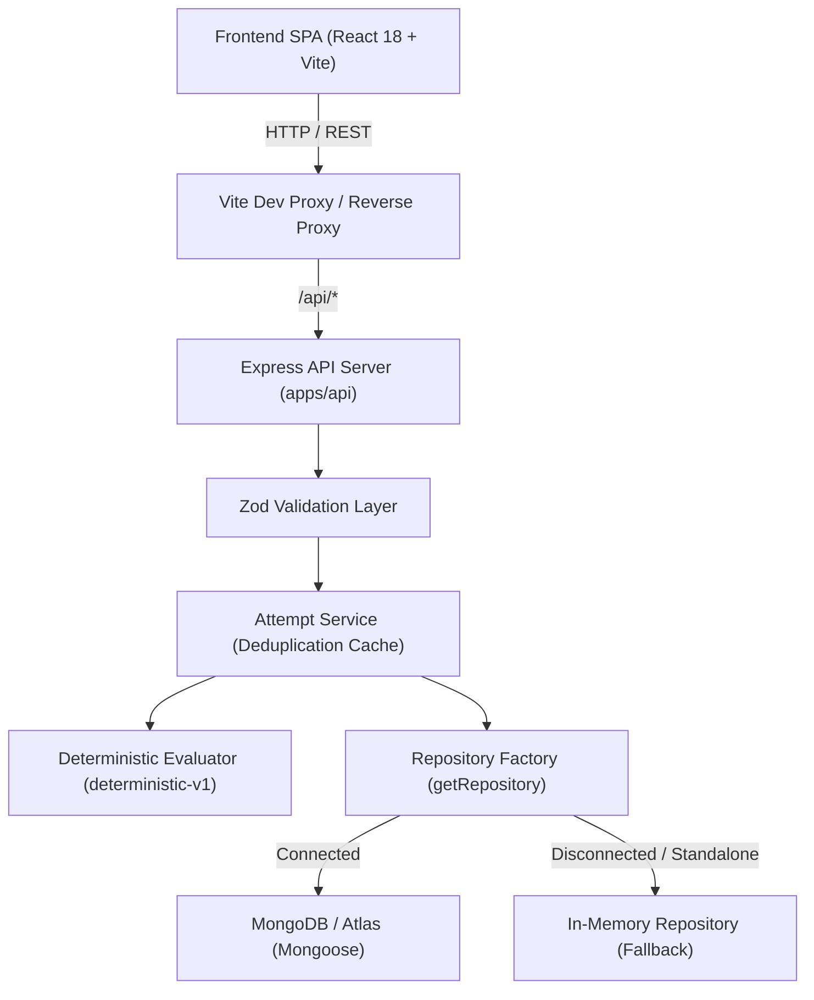

# DesignKarlo

> Low-Level Design (LLD) practice platform with iterative, evidence-based feedback and revision comparison.

Built and designed by [Shrajal Pandey](https://github.com/shrajal01)

DesignKarlo is a full-stack platform engineered to help software engineers, interview candidates, and students practice Low-Level Design problems. It replaces subjective, passive study methods with a structured design workflow: candidates formulate object-oriented solutions using a standardized architectural schema, receive automated, principle-anchored rubric feedback, revise their models, and track tangible architectural improvements across sequential revisions.

---

## Overview

### Target Users
- Software engineers preparing for Low-Level Design (LLD) and Object-Oriented Design (OOD) technical interviews.
- Engineering candidates seeking structured, deliberate practice rather than passive video consumption.
- Evaluators and interviewers seeking a standardized, evidence-grounded framework to assess candidate design maturity.

### Problem Being Solved
Low-Level Design preparation suffers from three persistent industry bottlenecks:
1. **Ambiguous Feedback Loop:** When engineers practice problems such as *Parking Lot* or *Rate Limiter*, they typically sketch on freehand whiteboards or read static blog solutions. There is no objective critique to evaluate whether class decomposition is cohesive, interfaces are properly segregated, or coupling risks exist.
2. **Algorithmic Tool Mismatch:** Conventional practice platforms (such as LeetCode or HackerRank) evaluate binary algorithmic input/output correctness. They cannot assess object-oriented modularity, encapsulation, extensibility, or design pattern applicability.
3. **Diagramming Overhead vs. Thought Clarity:** Visual drag-and-drop UML tools consume excessive time manipulating canvas shapes and connection arrows rather than refining domain boundaries, contracts, state transitions, and encapsulation.
4. **Shallow AI Critiques:** Generic chat-based AI evaluations produce inconsistent, one-shot ratings without rubric persistence, multi-attempt continuity, or structured diffs between revisions.

### The Value of Iterative Feedback
Architectural maturity develops through deliberate revision. DesignKarlo enables candidates to:
- Formulate a concrete structured solution against real-world constraints.
- Receive immediate, deterministic critique anchored in SOLID principles and domain modeling rules.
- Address identified architectural concerns by refining responsibilities, introducing interfaces, or applying design patterns.
- Quantitatively inspect improvement through side-by-side revision comparisons showing score deltas and resolved concerns.

---

## Core Features

- **Curated Problem Catalog:** Browse Low-Level Design challenges with explicit functional requirements, non-functional constraints, starter design templates, and rubric dimension weighting (active catalog includes the *Parking Lot System*).
- **Structured Design Editor:** Form-based architectural submission editor organized into five distinct domain sections:
  - *Operational Assumptions:* System scope and operating constraints.
  - *Classes and Responsibilities:* Entity declarations with explicit types (`class`, `interface`, `abstract_class`, `enum`), responsibilities, attributes, and methods. Renaming an entity automatically updates referenced relationships and design patterns.
  - *Relationships:* Explicit directional connections (`has_a`, `has_many`, `uses`, `implements`, `extends`) between declared entities.
  - *Design Patterns Applied:* Selected patterns (e.g., Strategy, Factory, Observer) with target entities and architectural justifications.
  - *Edge Cases and Concurrency:* Specific failure modes, capacity limits, race conditions, and synchronization considerations.
- **JSON-to-Form Importer with Auto-Normalization:** Raw JSON import tab featuring schema normalization. Automatically defaults omitted optional arrays (`attributes`, `methods`, `relationships`, `designPatterns`), converts object notation (`{ name, type }`) to string declarations, normalizes field aliases (`edgeCases` to `edgeCasesConsidered`), validates schema constraints before applying, presents readable error messages, and preserves the existing form draft if import fails.
- **Field-Level Validation and Error Anchors:** Instant client-side and server-side Zod validation. Identifies syntax violations (e.g., spaces or parentheses in entity identifiers), undeclared target entities, empty responsibilities, or truncated justifications. A top-level summary banner provides error counts and clickable jump-to-field links that scroll directly to the invalid inputs.
- **Deterministic Rubric Evaluation (`deterministic-v1`):** A 100-point rule-based evaluation engine scoring four distinct dimensions (25 points each): Domain Entities, SOLID and Modularity, Extensibility and Patterns, and Edge Cases and Concurrency. Generates structured feedback categorized into strengths, architectural concerns, and actionable revision suggestions.
- **Revision History and Progression:** Tracks sequential revisions within each practice attempt (Revision #1, Revision #2, etc.). Each revision stores an immutable snapshot of the design, timestamp, evaluation results, and parent revision linkage.
- **Multi-Revision Comparison:** Side-by-side comparison modal displaying score deltas (+/- points), resolved architectural concerns, newly introduced issues, and persistent unresolved concerns.
- **Hybrid Dual Persistence:** Transparent repository architecture supporting MongoDB/Atlas when configured, with seamless automatic fallback to an in-memory repository when MongoDB is offline. The active persistence mode is broadcast via the `X-Persistence-Mode` response header and displayed in the UI.
- **Duplicate Submission Protection:** SHA-256 payload hashing with a 5-second window prevents accidental duplicate revisions caused by double-clicking or rapid resubmission.
- **Application Resilience:** Neo-brutalist React Error Boundary prevents unhandled render exceptions from producing blank screens and provides direct view-recovery controls.

---

## Practice Workflow

```
Choose Problem -> Design Solution -> Submit -> Receive Feedback -> Revise -> Compare Attempts
```

1. **Choose Problem:** Select an LLD problem from the catalog to review requirements, constraints, and starter templates.
2. **Design Solution:** Define domain entities, responsibilities, relationships, applied design patterns, and concurrency considerations using the structured form or the JSON importer.
3. **Submit:** Submit the design to run schema validation and automated rubric evaluation.
4. **Receive Feedback:** Review the overall score, dimensional rubric breakdown, identified architectural risks, and actionable recommendations.
5. **Revise:** Modify the design directly within the editor to decouple responsibilities, introduce interfaces, or handle edge cases.
6. **Compare Attempts:** Select any two historical revisions in the comparison modal to evaluate architectural score progression and verify resolved concerns.

---

## Technology Stack

### Monorepo Architecture
- **Package Manager:** npm workspaces (`apps/*`)
- **Task Orchestration:** Concurrently (concurrent execution of backend and frontend processes in local development)

### Frontend (`apps/web`)
- **Framework:** React 18 (`react`, `react-dom` `^18.3.1`)
- **Build Tool:** Vite 6 (`vite` `^6.1.0`, `@vitejs/plugin-react` `^4.3.4`)
- **Language:** TypeScript 5 (`typescript` `^5.7.3`)
- **Styling:** Tailwind CSS 3 (`tailwindcss` `^3.4.17`, `postcss`, `autoprefixer`)
- **Design System:** Neo-Brutalism (high-contrast borders, solid offset drop-shadows, warm `#FDFBF7` canvas, `#CCFF00` accents)
- **Icons:** Lucide React (`lucide-react` `^0.475.0`)
- **Testing:** Vitest (`vitest` `^3.0.5`), React Testing Library (`@testing-library/react` `^16.2.0`, `@testing-library/jest-dom` `^6.6.3`), JSDOM (`jsdom` `^26.0.0`)

### Backend (`apps/api`)
- **Runtime:** Node.js (>=18.0.0, Express `^4.21.2`)
- **Language / Execution:** TypeScript 5 (`typescript` `^5.7.3`), `tsx` (`^4.19.3` for live development watch mode)
- **Validation:** Zod (`zod` `^3.24.2`) for environment configuration and submission schema enforcement
- **Database / ODM:** MongoDB via Mongoose (`mongoose` `^8.10.0`), with in-memory repository fallback
- **Utilities:** `cors` (`^2.8.5`), `dotenv` (`^16.4.7`)
- **Testing:** Vitest (`vitest` `^3.0.5`), Supertest (`supertest` `^7.0.0`)

---

## Project Structure

```
DesignKarlo/
├── apps/
│   ├── api/
│   │   ├── src/
│   │   │   ├── config/          # Environment variables (env.ts) and database setup (db.ts)
│   │   │   ├── domain/          # Domain models, submission schemas, problem definitions, evaluator
│   │   │   │   ├── evaluator/   # Deterministic rubric evaluation engine & criteria rules
│   │   │   │   ├── models/      # Mongoose schemas (Attempt, Submission)
│   │   │   │   ├── problems/    # Problem catalog registry (Parking Lot)
│   │   │   │   ├── schemas/     # Zod validation schemas for structured submissions
│   │   │   │   └── types/       # Domain TypeScript type definitions
│   │   │   ├── middleware/      # Error handling and validation middlewares
│   │   │   ├── repositories/    # IAttemptRepository (Mongo & In-Memory implementations)
│   │   │   ├── routes/          # Express route definitions (health, problems, attempts)
│   │   │   ├── services/        # Attempt service orchestration & duplicate caching
│   │   │   ├── tests/           # Vitest integration and unit test suites
│   │   │   ├── app.ts           # Express application definition and middleware pipeline
│   │   │   └── index.ts         # Server bootstrap, port listening, database initialization
│   │   ├── .env.example         # Backend environment template
│   │   ├── package.json         # Backend dependencies and scripts
│   │   └── tsconfig.json        # Backend TypeScript configuration
│   └── web/
│       ├── src/
│       │   ├── api/             # API client and error wrappers (client.ts)
│       │   ├── components/      # React UI components (Editor, Catalog, Evaluation, History, etc.)
│       │   ├── utils/           # Validation engine (validation.ts) and JSON importer (importer.ts)
│       │   ├── App.tsx          # Main application page, state orchestration, layout
│       │   ├── App.test.tsx     # Vitest component integration tests
│       │   ├── validation.test.tsx # Form validation and JSON importer regression tests
│       │   ├── index.css        # Tailwind directives and neo-brutalist styles
│       │   ├── main.tsx         # React DOM root entry
│       │   ├── test-setup.ts    # Vitest DOM matchers setup
│       │   └── types.ts         # Frontend TypeScript type definitions
│       ├── index.html           # HTML application entry point
│       ├── package.json         # Frontend dependencies and scripts
│       ├── tailwind.config.js   # Tailwind design tokens and custom styles
│       ├── tsconfig.json        # Frontend TypeScript configuration
│       └── vite.config.ts       # Vite configuration and dev server proxy settings
├── docs/
│   ├── design-note.md           # Architecture design note and domain specification
│   └── research-note.md         # Problem analysis, market landscape, and research findings
├── .env.example                 # Root environment template
├── .gitignore                   # Monorepo git ignore rules
├── AI_USAGE.md                  # Log of AI usage, workflow, and engineering decisions
├── package.json                 # Monorepo root configuration and workspace scripts
└── README.md                    # Project documentation
```

---

## Architecture and Design Decisions

DesignKarlo follows a layered, decoupled architecture to ensure testability, maintainability, and operational resilience:



### Key Architectural Decisions
1. **Decoupled Server Configuration (`app.ts` vs. `index.ts`):** The Express application configuration, middleware, and route mounting are isolated in `src/app.ts`. The process listener and database connection bootstrap reside in `src/index.ts`. This allows integration test suites (using Supertest) to execute against the application in-memory without binding TCP ports or initiating network listeners.
2. **Structured Text/Form Modeling over Visual Drag-and-Drop:** Visual UML diagramming was deliberately rejected in favor of structured text and form schemas. Structured data is faster to write, version-controllable, straightforward to diff, and reliably validated against strict schemas without canvas positioning overhead.
3. **Repository Pattern for Dual Persistence:** The `IAttemptRepository` interface decouples business logic from storage mechanisms. When a valid `MONGODB_URI` connects successfully, `MongoAttemptRepository` manages document persistence. If MongoDB is unreachable or unconfigured, the application falls back to `InMemoryAttemptRepository` without crashing, enabling seamless local testing and evaluation.
4. **Deterministic Evaluation Engine over Unconstrained LLM Calls:** Live LLM grading was excluded from the core evaluation pipeline in favor of `deterministic-v1`. This guarantees instant feedback, zero external API token costs, repeatable scores across submissions, and predictable rubric analysis.
5. **Defensive Importer and Form Resilience:** The JSON importer normalizes data structures (defaulting arrays, mapping aliases, and converting object notations) and validates schemas before modifying state. If an imported payload is invalid, the existing form state is preserved, and actionable error messages are displayed. React Error Boundaries wrap the editor to prevent runtime rendering faults from crashing the page.

---

## Prerequisites, Installation, and Setup

### 1. Prerequisites
- **Node.js:** v18.0.0 or higher (v20+ recommended)
- **npm:** v9.0.0 or higher
- **Git:** Installed and configured
- **MongoDB:** Optional. If MongoDB is not running locally or via Atlas, the backend automatically operates in in-memory standalone mode.

### 2. Installation
Clone the repository and install all monorepo dependencies from the project root:

```bash
git clone https://github.com/shrajal01/DesignKarlo.git
cd DesignKarlo
npm install
```

### 3. Environment Configuration
Copy the root `.env.example` file to `.env`:

```bash
cp .env.example .env
```

The configuration variables in `.env` are defined as follows:

| Variable | Default Value | Description |
| :--- | :--- | :--- |
| `PORT` | `5000` | Port on which the Express API server listens. |
| `NODE_ENV` | `development` | Runtime environment (`development`, `production`, `test`). |
| `API_PREFIX` | `/api` | Base path prefix for all API routes. |
| `CLIENT_URL` | `http://localhost:5173` | Allowed CORS origin for the frontend client. |
| `MONGODB_URI`| `mongodb://localhost:27017/designkarlo` | MongoDB or Atlas connection URI. If connection fails or times out, the server logs a notice and activates in-memory standalone mode. |

*Note on Configuration Loading:* The backend environment loader in `apps/api/src/config/env.ts` searches for `.env` files across both the monorepo root and the workspace directory, ensuring commands like `npm run dev` and `npm run dev:api` load root environment variables consistently.

### 4. Running Locally
Start both backend and frontend applications concurrently from the repository root:

```bash
npm run dev
```

- **Frontend:** Accessible at `http://localhost:5173`
- **Backend API:** Accessible at `http://localhost:5000/api`

---

## Available Scripts

All scripts are executed from the monorepo root:

### Development
```bash
# Run both Frontend (Vite) and Backend (Express) concurrently
npm run dev

# Run only the Backend API server with hot-reloading (tsx watch)
npm run dev:api

# Run only the Frontend Web application (Vite)
npm run dev:web
```

### Building
```bash
# Type-check and build both workspaces for production
npm run build

# Build only the Backend (dist/)
npm run build:api

# Build only the Frontend (dist/)
npm run build:web
```

### Testing
```bash
# Run test suites across all workspaces
npm run test

# Run Backend tests only (Vitest + Supertest)
npm run test:api

# Run Frontend tests only (Vitest + React Testing Library)
npm run test:web

# Clean build artifacts across workspaces if present
npm run clean
```

---

## API Reference

All routes are prefixed with `/api`.

### 1. Health and System Status
- **Endpoint:** `GET /api/health`
- **Description:** Returns service status, uptime, environment, and database connection state.
- **Response (200 OK):**
  ```json
  {
    "status": "ok",
    "service": "designkarlo-api",
    "timestamp": "2026-10-14T20:00:00.000Z",
    "uptime": 12,
    "environment": "development",
    "database": "connected"
  }
  ```
  *(Note: Returns `"database": "disconnected (standalone mode)"` when running without MongoDB).*

### 2. Problem Catalog
- **Endpoint:** `GET /api/problems`
  - **Description:** Lists all available LLD problems with summaries and rubric dimensions.
  - **Response (200 OK):** `{ "success": true, "data": [ ... ] }`
- **Endpoint:** `GET /api/problems/:slug`
  - **Description:** Returns detailed problem specification, requirements, constraints, rubric criteria, starter template, and sample solution.
  - **Response (200 OK):** `{ "success": true, "data": { ... } }`
  - **Response (404 Not Found):** If problem slug does not exist.

### 3. Attempts and Submissions
- **Endpoint:** `POST /api/attempts`
  - **Description:** Starts a new attempt or resumes an existing active in-progress attempt for an anonymous user ID.
  - **Request Body:**
    ```json
    {
      "problemSlug": "parking-lot",
      "anonymousUserId": "anon_12345"
    }
    ```
  - **Response (201 Created / 200 OK):** `{ "success": true, "data": Attempt, "meta": { "isNew": boolean } }`
- **Endpoint:** `GET /api/attempts?userId=:userId`
  - **Description:** Returns all attempts created by a specific anonymous user ID.
  - **Response (200 OK):** `{ "success": true, "data": Attempt[] }`
- **Endpoint:** `GET /api/attempts/:id`
  - **Description:** Fetches attempt metadata along with all associated historical submissions.
  - **Response Headers:** `X-Persistence-Mode: in-memory | mongodb`
  - **Response (200 OK):** `{ "success": true, "data": { ...attempt, "submissions": [ ... ] }, "meta": { "persistenceMode": string } }`
- **Endpoint:** `POST /api/attempts/:id/submissions`
  - **Description:** Submits a structured design solution for validation and deterministic rubric evaluation.
  - **Request Body:** `StructuredDesign` object containing `problemSlug`, `assumptions`, `entities`, `relationships`, `designPatterns`, and `edgeCasesConsidered`.
  - **Response Headers:** `X-Persistence-Mode: in-memory | mongodb`
  - **Response (201 Created / 200 OK if duplicate within 5s):** `{ "success": true, "data": Submission, "meta": { "isDuplicate": boolean, "persistenceMode": string } }`
  - **Response (400 Bad Request):** If submission payload fails Zod schema validation (returns path-specific error details).
- **Endpoint:** `GET /api/attempts/:id/submissions/:subId`
  - **Description:** Fetches a specific historical submission snapshot.
  - **Response (200 OK):** `{ "success": true, "data": Submission, "meta": { "persistenceMode": string } }`

### 4. Revision Comparison
- **Endpoint:** `GET /api/attempts/:id/compare?revA=:revA&revB=:revB`
  - **Description:** Compares two revisions within an attempt, calculating score deltas and concern diffs.
  - **Query Parameters:** `revA` (positive integer), `revB` (positive integer).
  - **Response (200 OK):**
    ```json
    {
      "success": true,
      "data": {
        "comparison": {
          "previousRevisionNumber": 1,
          "scoreDelta": 15,
          "resolvedConcerns": ["Missing Interface Decoupling"],
          "unresolvedConcerns": [],
          "newConcerns": [],
          "summary": "Progress detected between Revision 1 and current revision: score changed by +15 points. Resolved 1 design concern(s): Missing Interface Decoupling."
        },
        "revisionA": { "revisionNumber": 1, "overallScore": 65, "submittedAt": "..." },
        "revisionB": { "revisionNumber": 2, "overallScore": 80, "submittedAt": "..." }
      },
      "meta": { "persistenceMode": "mongodb" }
    }
    ```

---

## Evaluation Approach

### Rubric Dimensions
DesignKarlo scores submissions against four foundational architectural dimensions (total 100 points, 25 points each):
1. **Domain Entities (25 pts):** Evaluates whether core problem concepts are represented as discrete entities, class attributes and methods are properly modeled, and relationships span appropriate domain entities.
2. **SOLID and Modularity (25 pts):** Analyzes Single Responsibility Principle adherence (detecting god-classes with excessive responsibilities), interface decoupling, and cohesive class boundaries.
3. **Extensibility and Patterns (25 pts):** Evaluates appropriate design pattern selection (e.g., Strategy pattern for allocation or fee calculation algorithms), valid pattern targets, and concrete architectural justifications.
4. **Edge Cases and Concurrency (25 pts):** Evaluates operational edge-case coverage (e.g., lot capacity saturation, invalid tickets, concurrent spot allocation, race conditions, and synchronization handling).

### Feedback Structure
Each evaluation generates:
- **Overall Score:** Calculated integer score bounded between 0 and 100.
- **Criterion Breakdown:** Dimensional scores with descriptions.
- **Categorized Feedback Items:**
  - `strength`: Commends sound architectural choices and proper pattern usage.
  - `concern`: Identifies architectural debt, tight coupling, missing abstractions, or unhandled concurrency.
  - `suggestion`: Provides concrete, actionable recommendations for the next revision.

### Progression Tracking
When a submission is evaluated after a prior revision, the engine executes `compareEvaluations` to compute:
- `scoreDelta`: Mathematical difference in overall score.
- `resolvedConcerns`: Prior architectural concerns that were successfully addressed.
- `unresolvedConcerns`: Lingering concerns requiring attention.
- `newConcerns`: New architectural issues introduced during the revision.
- `summary`: Human-readable evaluation narrative.

### Status of LLM Grading
**LLM grading is absent from the current implementation.** The evaluation system uses a 100% deterministic, offline-capable rule engine (`deterministic-v1`). This architectural decision ensures instant evaluation speed, zero external API token costs, repeatable scores across identical submissions, and immunity to non-deterministic LLM grading drift.

---

## Testing and Build Verification

The application maintains comprehensive automated test suites covering backend endpoints, domain schemas, evaluation rules, frontend rendering, field validation UX, and crash regression scenarios.

### Last Reported Verification Results
*As verified on October 14, 2026:*
- **Backend API Tests (`npm run test:api`):** 7 test files passed, 47 tests passed (100% passing).
  - `repository.test.ts` (in-memory repository operations)
  - `parking-lot-problem.test.ts` (problem catalog integrity)
  - `submission-schema.test.ts` (Zod validation and error formatting)
  - `deterministic-evaluator.test.ts` (rubric scoring and comparison logic)
  - `db-config.test.ts` (MongoDB URI masking and environment parsing)
  - `health.test.ts` (health endpoint contract)
  - `attempts-api.test.ts` (full HTTP lifecycle: attempts, submissions, deduplication, comparisons)
- **Frontend Web Tests (`npm run test:web`):** 2 test files passed, 18 tests passed (100% passing).
  - `App.test.tsx` (app rendering, navigation, and API status verification)
  - `validation.test.tsx` (frontend validation engine, error location formatting, rename cascading, custom JSON normalization, and crash prevention)
- **Production Build (`npm run build`):** Clean compilation across both workspaces (`tsc` for backend, `tsc && vite build` for frontend).

### Running Verification Locally
```bash
# Execute backend test suite
npm run test:api

# Execute frontend test suite
npm run test:web

# Execute full production build
npm run build
```

---

## Deployment

The application is structured for standard cloud deployment (e.g., Render, Railway, Vercel, or AWS ECS).

The live deployment URL will be added here once deployment to public hosting infrastructure is executed.

---

## Documentation Links

- [Technical Design Note](docs/design-note.md): Domain concepts, submission schemas, architectural trade-offs, and state models.
- [Research Note](docs/research-note.md): LLD learner pain point analysis, market tool landscape, and hypothesis verification matrix.
- [AI Usage Log](AI_USAGE.md): Detailed record of AI pair-programming assistance, engineering decisions, and verification steps.

---

## Genuine Limitations and Future Improvements

### Genuine Limitations
1. **Catalog Scope:** Currently features one complete problem specification (*Parking Lot System*). Additional classic problems (*Rate Limiter*, *Elevator System*) are documented in architecture notes but not yet registered in the active API catalog.
2. **Anonymous Session Scope:** Sessions rely on browser `localStorage` (`dk_anonymous_user_id`). Clearing browser storage or switching browsers resets attempt history visibility.
3. **Deterministic Heuristic Boundaries:** The `deterministic-v1` evaluation engine relies on structural heuristics and pattern keyword matching. While fast, predictable, and cost-free, it does not interpret novel semantic design justifications beyond its configured criteria.

### Future Improvements
- **Problem Catalog Expansion:** Register additional classic LLD problems (*Elevator System*, *Movie Ticket Booking System*, *Rate Limiter*, *Snake and Ladder*).
- **User Authentication:** Introduce lightweight account authentication (OAuth/JWT) to synchronize attempts across multiple devices and persist long-term portfolios.
- **Hybrid Semantic Evaluation:** Optional opt-in LLM evaluation layer operating as an advisory critique alongside the deterministic score.
- **Dynamic Mermaid Diagram Generation:** Render interactive, read-only class diagrams dynamically from the structured design submission to provide immediate visual feedback.

---

## License Status

This project is maintained as a private repository. All rights reserved.
