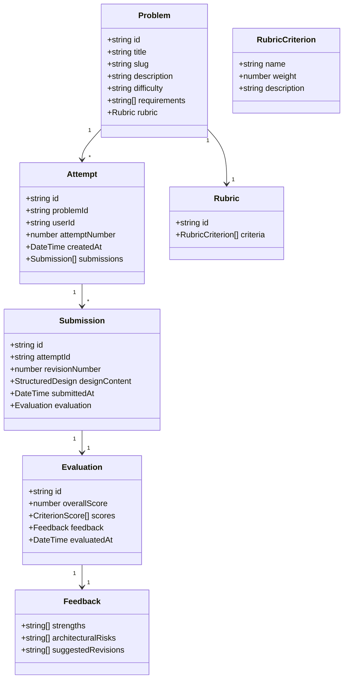

# DesignKarlo — Technical Design Note

**Status:** Draft Architecture Specification  
**Phase:** 1 — Foundation & Monorepo Setup  
**Target Milestone:** MVP (2-Day Sprint)

---

## 1. Intended MVP User Journey

1. **Browse & Select Problem:**
   * The learner enters DesignKarlo and views a curated library of Low-Level Design problems (e.g., *Parking Lot*, *Snake and Ladder*, *Rate Limiter*).
   * Problem cards detail real-world requirements, functional constraints, and non-functional goals.

2. **Formulate Solution (Structured Text-Based Submission):**
   * Instead of wrestling with canvas diagrams, the learner writes their design in a structured, markdown-like format with designated sections (Entities, Relationships, Design Patterns, SOLID Considerations, API Contracts).

3. **Submit Solution:**
   * The candidate submits their design as an **Attempt**.
   * The submission is validated against structural constraints and queued for automated rubric evaluation.

4. **Review Evidence-Based Feedback:**
   * The system presents clear, itemized feedback broken down across rubric dimensions (e.g., Modularity, Extensibility, Interface Segregation, Concurrency Handling).
   * Each critique provides actionable advice rather than vague commentary.

5. **Revise Solution:**
   * Learner creates a new revision based on the critique, adjusting classes or decoupling components.

6. **Compare Attempts:**
   * The learner views a side-by-side progression showing score evolution, modified entities, and how architectural debt was reduced.

---

## 2. Candidate Domain Concepts



* **Problem:** The architectural specification, requirements, constraints, and associated rubric.
* **Attempt:** A learner's multi-revision journey tackling a specific problem.
* **Submission:** A discrete snapshot of the learner's design solution at a specific revision index.
* **Rubric:** Standardized criteria against which the submission is evaluated.
* **Evaluation:** Quantitative score breakdown and qualitative analysis computed against the rubric.
* **Feedback:** Principle-anchored insights detailing strengths, architectural violations, and recommendations.

---

## 3. Structured Text-Based Design Submission Format

To avoid drag-and-drop complexity and ensure deterministic evaluation, designs will be submitted in structured JSON/Markdown schemas:

```yaml
problemSlug: "parking-lot-system"
assumptions:
  - "Multi-floor parking lot supporting Motorcycles, Compact Cars, and Large Trucks."
  - "Spot allocation uses nearest-to-entrance strategy."
entities:
  - name: "ParkingLot"
    type: "class"
    responsibilities:
      - "Maintains floors registry and active tickets."
    relations:
      - target: "ParkingFloor"
        type: "has_many"
  - name: "ParkingFloor"
    type: "class"
    responsibilities:
      - "Tracks available spots by vehicle type."
patternsUsed:
  - pattern: "Strategy Pattern"
    context: "SpotAssignmentStrategy allows swapping between NearestSpot and RandomSpot."
solidComplianceNotes:
  singleResponsibility: "FareCalculation is separated into a dedicated PricingService."
  openClosed: "New vehicle types can be introduced without modifying spot allocation core logic."
```

---

## 4. Evaluation Strategy & Trade-Offs

### Options Considered:
1. **Rule-Based Static AST / Linter:**
   * *Pros:* 100% deterministic, instant execution, zero API token cost.
   * *Cons:* Brittle; cannot assess qualitative semantic nuances of design reasoning.
2. **One-Shot LLM Prompting:**
   * *Pros:* Highly expressive, understands design intent easily.
   * *Cons:* Non-deterministic, prone to score drift across submissions, hallucination risks.
3. **Hybrid Rubric-Anchored LLM Pipeline (Selected Direction):**
   * *Approach:* Use strict Zod schema validation on output, rigid system prompts referencing the problem rubric, temperature = 0.1 for high determinism, and structured diff prompts comparing Attempt $N$ with Attempt $N-1$.
   * *Trade-off:* Moderate API token usage and slightly higher latency (~3-5s), but delivers consistent and deeply useful critiques.

---

## 5. Attempt Preservation & Comparison

* Every submission within an attempt is immutable once evaluated.
* Revisions store:
  1. The complete structured design payload.
  2. Timestamp and evaluation snapshot.
  3. Parent revision reference (`previousSubmissionId`).
* The frontend comparison view computes entity-level diffs and score deltas between any two selected revisions.

---

## 6. Important Unresolved Decisions

1. **Anonymous Practice vs. Authentication:**
   * *Decision pending for Phase 2:* Should Phase 2 support anonymous attempts using localStorage / session tokens before introducing full user authentication?
2. **Evaluation Asynchrony:**
   * For the 2-day MVP, should evaluation run synchronously via HTTP request or asynchronously with a lightweight polling mechanism?
3. **Diagram Generation:**
   * Should the platform render Mermaid class diagrams dynamically from the structured text submission as a read-only visual aid? (Highly recommended for visual appeal without canvas overhead).
