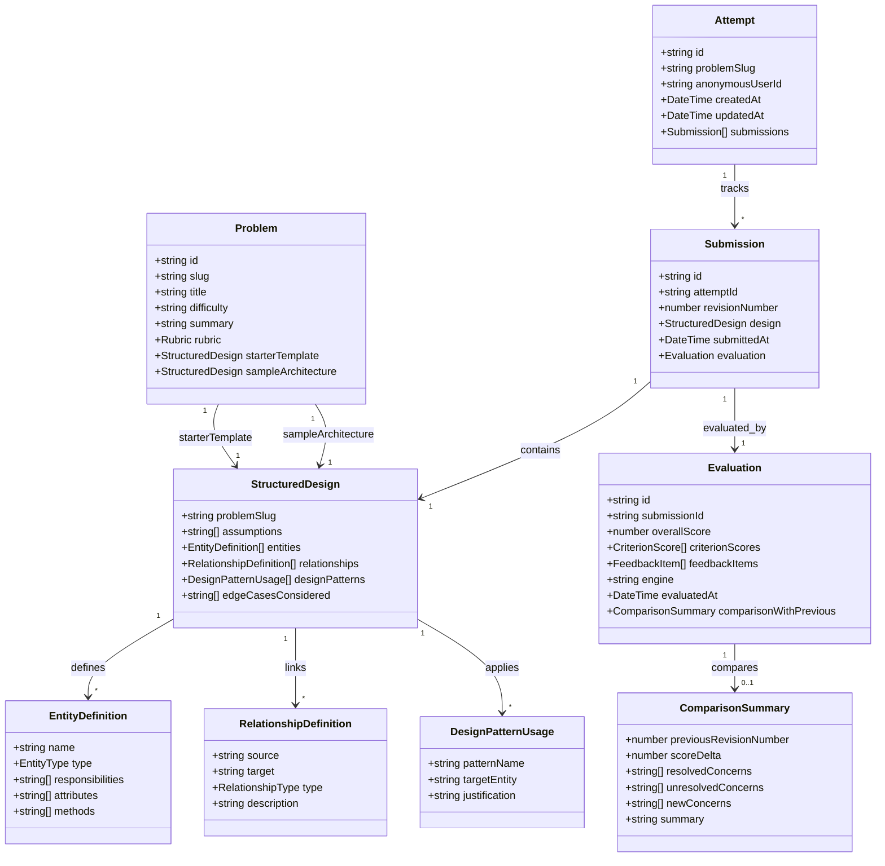

# DesignKarlo — Technical Design Note

**Document Status:** Final MVP Implementation Architecture<br />
**System Version:** 0.1.0<br />
**Target Problem:** Parking Lot System<br />
**Repository:** [https://github.com/shrajal01/DesignKarlo](https://github.com/shrajal01/DesignKarlo)<br />
**Live Frontend:** [https://designkarlo.netlify.app/](https://designkarlo.netlify.app/)<br />
**Live API Base:** [https://designkarlo-api.onrender.com/](https://designkarlo-api.onrender.com/)<br />
**API Health Check:** [https://designkarlo-api.onrender.com/api/health](https://designkarlo-api.onrender.com/api/health)

---

## 1. Product Overview and Scope

DesignKarlo is an interactive Low-Level Design (LLD) and Object-Oriented Design (OOD) practice platform engineered to help software engineers transition from passive study to active, deliberate architectural modeling.

Traditional preparation relies heavily on static blog posts, video walkthroughs, or freeform diagramming without objective feedback. DesignKarlo addresses this gap by providing:
- A standardized, schema-driven architectural authoring environment.
- Automated, deterministic rubric evaluation.
- Categorized, evidence-backed feedback (strengths, concerns, and actionable suggestions).
- Multi-revision tracking and delta comparison that quantifies architectural progression.

### Scope of the Implemented MVP
The current production MVP is focused on **The Parking Lot System**, an industry-standard object-oriented design problem requiring domain decomposition, interface decoupling, vehicle spot allocation strategies, pricing policies, and concurrency safeguards.

### Modeling Paradigms: Structured Input vs. Canvas
Visual drag-and-drop UML tools (such as Draw.io or Lucidchart) consume excessive time positioning bounding boxes and alignment arrows rather than refining domain boundaries, responsibilities, and contracts. DesignKarlo replaces visual canvas manipulation with a **structured form and JSON architecture editor**. This structure enables:
- Immediate schema-level and semantic validation.
- Clean JSON diffing across sequential revisions.
- Instant, deterministic rule-based evaluation without layout-parsing ambiguity.

---

## 2. Actual User Journey

The implemented application supports two distinct learning pathways and a continuous revision loop:

```
[Problem Catalog]
       │
       ├───► [Guided Practice Flow] ──► Problem Briefing View ──► "Start Designing" ──┐
       │                                                                               ▼
       └───► [Direct Start Flow] ─────────────────────────────────────────────► [Structured Editor]
                                                                                       │
                                                                             ┌─────────┴─────────┐
                                                                             ▼                   ▼
                                                                        [Form Mode]         [JSON Mode]
                                                                             │                   │
                                                                             └─────────┬─────────┘
                                                                                       ▼
                                                                             [Client Validation]
                                                                                       │
                                                                                       ▼
                                                                             [Submit Architecture]
                                                                                       │
                                                                                       ▼
                                                                             [Deterministic Evaluation]
                                                                                       │
                                                                                       ▼
                                                                             [Scorecard & Critique]
                                                                                       │
                                                                                       ▼
                                                                             [Revise & Compare]
```

### A. Catalog and Problem Briefing
1. **Problem Catalog:** The learner views available problems with summaries, difficulty ratings, and weighted rubric dimensions (active problem: *Parking Lot System*).
2. **Guided Practice Session Flow:** Clicking "Start Practice Session" opens the **Problem Briefing** screen. This view presents domain context, functional requirements (multi-floor support, spot allocation, ticket issuance, fee calculation), non-functional constraints (concurrency, atomicity), domain assumptions, and operational edge cases. Learners review this context before clicking "Start Designing" to open the editor.
3. **Direct Start Attempt Flow:** Clicking "Start Attempt" directly from the problem specification or attempting to resume an active attempt bypasses the briefing screen and immediately opens the design editor. Attempt records in the database are initialized only when the user enters the editor.

### B. Structured Architectural Authoring
Learners formulate their designs using two synchronized editing modes:
- **Form Mode:** An interactive structured interface organized into 5 domain sections:
  1. *Operational Assumptions:* Capacity, vehicle types, and operating boundaries.
  2. *Classes and Responsibilities:* Entity declarations with explicit types (`class`, `interface`, `abstract_class`, `enum`), responsibilities, attributes, and methods. Renaming an entity automatically updates referenced relationships and design patterns.
  3. *Relationships:* Directional dependencies (`has_a`, `has_many`, `uses`, `implements`, `inherits`, `aggregates`, `composes`) between declared entities.
  4. *Design Patterns Applied:* Selected patterns (e.g., Strategy, Factory, Observer) with target entities and architectural justifications.
  5. *Edge Cases and Concurrency:* Specific failure modes, capacity limits, race conditions, and synchronization considerations.
- **JSON Mode with Auto-Normalizing Importer:** Raw JSON editor allowing users to paste external models. The importer automatically defaults omitted optional arrays (`attributes`, `methods`, `relationships`, `designPatterns`), converts object notation (`{ name, type }`) to string arrays, normalizes legacy field aliases (`edgeCases` to `edgeCasesConsidered`), validates against the schema, and preserves active draft state if validation fails.

### C. Distinct Starter Templates and Sample Architectures
- **Load Starter:** Injects a clean, minimal 2-class baseline (`ParkingLot`, `ParkingSpot`) for guided scaffolding.
- **Load Sample Architecture:** Injects a complete sample design featuring interfaces, controller entities, and strategy patterns (e.g., `ParkingLot`, `ParkingFloor`, `ParkingSpot`, `Vehicle`, `Ticket`, `Payment`, `IParkingStrategy`, `NearestSpotStrategy`, `IPricingStrategy`, `HourlyPricingStrategy`).
- **Safe Draft Replacement Confirmation:** When a user has modified the editor state, clicking either template button opens a modal warning dialog. If the user cancels, the in-progress draft is preserved. Confirming the dialog replaces the local editor state only—it does not create a submission or increment the revision counter.

### D. Validation and Submission
- Real-time client-side and server-side Zod validation checks entity syntax, unreferenced relations, duplicate entity names, and minimum string lengths.
- A summary banner lists validation errors with clickable jump-to-field links that scroll directly to invalid inputs.
- Submissions are sent via `POST /api/attempts/:id/submissions`. Rapid resubmissions within 5 seconds with identical SHA-256 hashes are throttled to prevent accidental duplicate revisions.

### E. Feedback, Revision, and Revision Comparison
- **Scorecard:** Displays the overall score (0–100) and dimensional scores across 4 rubric criteria.
- **Evidence-Backed Feedback:** Itemizes findings into `strength`, `concern`, and `suggestion` categories, linking issues to specific declared entities.
- **Revision History:** Stores immutable snapshots of each submission (Revision #1, Revision #2, etc.) under the attempt.
- **Revision Comparison Modal:** Select any two historical revisions to inspect mathematically computed score deltas (`+/-` points), resolved concerns, persistent unresolved concerns, and newly introduced issues.

---

## 3. Architecture and Technology Stack

DesignKarlo is structured as a decoupled monorepo managed via native npm workspaces:

```
DesignKarlo/
├── apps/
│   ├── api/               # Express REST API (Node.js + TypeScript)
│   │   ├── src/
│   │   │   ├── config/    # Environment parsing, db connection, and logging
│   │   │   ├── domain/    # Domain types, problem definitions, Zod schemas, evaluator
│   │   │   ├── middleware/# Error handler, CORS, and request logging
│   │   │   ├── models/    # Mongoose document schemas (Attempt, Submission)
│   │   │   ├── repositories/ # IAttemptRepository (Mongo & In-Memory)
│   │   │   ├── routes/    # Express routers (/health, /problems, /attempts)
│   │   │   ├── services/  # AttemptService (orchestration & deduplication)
│   │   │   └── tests/     # Vitest & Supertest test suites
│   │   └── package.json
│   └── web/               # Single-Page Application (React 18 + Vite)
│       ├── src/
│       │   ├── api/       # API client wrappers and error handling
│       │   ├── components/# React components (Editor, Briefing, Scorecard, History)
│       │   ├── utils/     # Form validation, error anchors, and JSON normalization
│       │   ├── App.tsx    # Root application orchestration and state
│       │   └── tests/     # Vitest & React Testing Library suites
│       └── package.json
├── docs/                  # Architecture specifications and research notes
├── package.json           # Root workspace configuration
└── README.md              # Project documentation
```

### Technology Matrix

| Layer | Technology | Version | Purpose |
| :--- | :--- | :--- | :--- |
| **Monorepo** | npm workspaces | `>=9.0.0` | Multi-package dependency management and unified script execution |
| **Frontend Framework** | React | `^18.3.1` | Component-driven UI architecture and local state management |
| **Frontend Build** | Vite | `^6.1.0` | Rapid development HMR and production bundle optimization |
| **Frontend Language** | TypeScript | `^5.7.3` | Type safety and domain interface alignment |
| **Styling** | Tailwind CSS | `^3.4.17` | Neo-brutalist design system (high-contrast borders, solid offset drop-shadows) |
| **Icons** | Lucide React | `^0.475.0` | UI iconography |
| **Backend Runtime** | Node.js | `>=18.0.0` | Server runtime environment |
| **Backend Framework** | Express | `^4.21.2` | REST API routing and middleware pipeline |
| **Backend Language** | TypeScript, `tsx` | `^5.7.3` | Type safety and live development watch execution |
| **Schema Validation** | Zod | `^3.24.2` | Environment variable validation and request payload schema enforcement |
| **Database ODM** | Mongoose | `^8.10.0` | MongoDB Atlas document modeling |
| **Persistence Fallback**| In-Memory Store | Custom | In-memory repository fallback for offline/standalone execution |
| **Testing** | Vitest, Supertest, RTL | `^3.0.5` | Unit, integration, and UI component testing |

### Decoupled Subsystem Responsibilities
- **Domain Layer (`apps/api/src/domain`):** Pure TypeScript business models, problem catalog definitions, Zod validation schemas, and rubric evaluation rules. Has zero dependencies on Express, Mongoose, or database drivers.
- **Evaluator Subsystem (`apps/api/src/domain/evaluator`):** Houses the deterministic rule-based evaluator engine (`deterministic-v1`). Executes scoring criteria against submitted architectural models and performs revision comparison diffing.
- **Repository Layer (`apps/api/src/repositories`):** Implements the Repository Pattern via the `IAttemptRepository` interface. Isolates document storage so business logic is agnostic to whether data is written to MongoDB Atlas or held in memory.
- **Service Layer (`apps/api/src/services`):** `AttemptService` coordinates attempt initialization, retrieval, duplicate submission caching (SHA-256 with 5-second window), and links evaluator outputs to repository persistence.
- **API Pipeline (`apps/api/src/app.ts` & `routes`):** Express pipeline handling CORS origin validation, JSON body parsing, route mapping, and standardized error handling. Decoupled from `index.ts` to allow in-memory Supertest integration testing without port binding.
- **Frontend SPA (`apps/web`):** Manages anonymous user identity (`localStorage`), problem catalog selection, dual-mode editing, real-time client validation, error anchor scrolling, and evaluation visualization.

---

## 4. Domain Model

The domain model represents candidate Low-Level Design submissions, rubric criteria, evaluation snapshots, and multi-revision progression:



### Domain Enumerations and Rules
- **`EntityTypeEnum`:** `class`, `interface`, `abstract_class`, `enum`.
- **`RelationshipTypeEnum`:** `has_a`, `has_many`, `inherits`, `implements`, `uses`, `aggregates`, `composes`.
- **Validation Constraints:**
  - Entity names must match `^[A-Za-z][A-Za-z0-9_]*$` (no whitespace or parentheses; interfaces must use type selection).
  - Entity names within a submission must be unique (case-insensitive check).
  - Every entity must declare at least one non-empty responsibility string.
  - Submissions must declare at least 2 distinct entities.
  - Relationship `source` and `target` must match declared entities.
  - Pattern `targetEntity` must match a declared entity.
  - Pattern `justification` must be at least 5 characters explaining design rationale.

---

## 5. Evaluation Engine

The evaluation system implements the `IEvaluationEngine` interface using a 100% deterministic rule engine: `deterministic-v1`.

### Four Equally Weighted Rubric Dimensions (25 Points Each, Total 100 Points)

1. **Domain Entity Modeling (25 pts):**
   - Evaluates whether core problem concepts are represented as discrete entities (e.g., `ParkingLot`, `ParkingFloor`, `ParkingSpot`, `Vehicle`, `Ticket`).
   - Verifies that entities declare attributes and methods.
   - Rewards appropriate structural modeling (minimum entity breadth and attribute coverage).
2. **Cohesion & SOLID Modularity (25 pts):**
   - Evaluates Single Responsibility Principle adherence.
   - Detects god-class anti-patterns (penalizes entities with 4 or more responsibilities combining unrelated domains such as parking allocation, payment processing, and ticket printing in a single class).
   - Evaluates interface decoupling: rewards solutions declaring contracts (e.g., `IParkingStrategy`, `IPricingStrategy`) and appropriate relationship cardinality (`implements`, `has_many`).
3. **Extensibility & Patterns (25 pts):**
   - Evaluates appropriate design pattern selection (Strategy, Factory, Observer).
   - Validates that pattern targets match declared entities.
   - Requires concrete architectural justifications explaining *why* the pattern was applied (e.g., swappable allocation algorithms or extensible pricing models).
4. **Edge Cases & Concurrency (25 pts):**
   - Evaluates documented coverage of capacity limits (full lot handling, spot type mismatch).
   - Evaluates concurrent spot allocation, race conditions, atomic ticket issuance, and synchronization safeguards.

### Feedback Items and Progression Tracking
Each dimension produces structured feedback items with:
- `type`: `strength` (positive reinforcement), `concern` (architectural risk or debt), `suggestion` (concrete advice for the next revision).
- `criterionId`: Dimensional anchor (`domain-entities`, `solid-modularity`, `extensibility-patterns`, `edge-cases-concurrency`).
- `message`: Specific narrative explaining the architectural critique.
- `targetEntity`: Optional entity identifier linking the critique to code.

When evaluating Revision $N$ where a prior Revision $N-1$ exists, the engine executes `compareEvaluations` to compute:
- `scoreDelta`: Mathematical difference ($Score_N - Score_{N-1}$).
- `resolvedConcerns`: Prior concerns from $N-1$ no longer present in $N$.
- `unresolvedConcerns`: Concerns persistent across both revisions.
- `newConcerns`: New architectural issues introduced in Revision $N$.
- `summary`: Human-readable narrative summarizing progress.

### Absence of Live LLM Evaluation
**Live LLM grading is intentionally not implemented in the active pipeline.** The engine relies strictly on deterministic AST-like inspection and heuristics. This ensures:
- Instant evaluation latency (<50ms).
- Zero third-party API dependencies or recurring token costs.
- 100% score reproducibility across identical submissions.
- Immunity to non-deterministic LLM grading variance.

---

## 6. API and Persistence Architecture

### API Route Endpoints
All API endpoints are mounted under `/api`:

| Method | Endpoint | Description | Key Response / Headers |
| :--- | :--- | :--- | :--- |
| `GET` | `/api/health` | Observability check returning uptime, environment, and database state | `{ status: "ok", database: "connected" \| "disconnected (standalone mode)" }` |
| `GET` | `/api/problems` | Lists all available problem specifications | `{ success: true, data: ProblemSummary[] }` |
| `GET` | `/api/problems/:slug` | Retrieves complete problem details, starter, and sample solution | `{ success: true, data: Problem }` |
| `POST` | `/api/attempts` | Initializes or resumes an attempt for an anonymous user ID | `201 Created` or `200 OK`, `{ success: true, data: Attempt, meta: { isNew } }` |
| `GET` | `/api/attempts?userId=:id`| Retrieves all attempts associated with an anonymous user ID | `{ success: true, data: Attempt[] }` |
| `GET` | `/api/attempts/:id` | Retrieves attempt metadata and all historical submissions | `X-Persistence-Mode: mongodb \| in-memory` |
| `POST` | `/api/attempts/:id/submissions` | Submits structured design for validation and evaluation | `201 Created` (or `200 OK` if duplicate within 5s) |
| `GET` | `/api/attempts/:id/submissions/:subId` | Retrieves a specific historical submission snapshot | `{ success: true, data: Submission }` |
| `GET` | `/api/attempts/:id/compare?revA=:a&revB=:b` | Compares two revisions, calculating score delta and concern diffs | `{ success: true, data: { comparison, revisionA, revisionB } }` |

### Dual Persistence with In-Memory Fallback
Persistence is abstracted via `IAttemptRepository`:
- **`MongoAttemptRepository`:** Operates when a valid `MONGODB_URI` connects successfully to MongoDB Atlas, managing Mongoose `AttemptModel` and `SubmissionModel` collections.
- **`InMemoryAttemptRepository`:** Operates automatically when MongoDB is unconfigured, unreachable, or times out during connection. Holds attempts and submissions in process memory.
- **Response Header Observability:** Every attempt response attaches the `X-Persistence-Mode` header (`mongodb` or `in-memory`), and the frontend `StorageBanner` renders a real-time status badge informing the user whether persistence is durable or ephemeral.

### Important Persistence Limitation
When running in standalone mode (using `InMemoryAttemptRepository`), **all attempt and revision history resides in server RAM and will be reset if the API process restarts**. MongoDB Atlas connection ensures durable document persistence.

---

## 7. Validation, Testing, Deployment, and Limitations

### Verified Automated Test Suite
Test suites are executed from the repository root:

- **Backend API Tests (`npm run test:api`):** **50 passed** across 7 test suites:
  - `repository.test.ts`: In-memory repository CRUD operations.
  - `parking-lot-problem.test.ts`: Problem catalog specification integrity.
  - `submission-schema.test.ts`: Zod schema enforcement and error paths.
  - `deterministic-evaluator.test.ts`: Rubric scoring rules and revision diffing.
  - `db-config.test.ts`: MongoDB connection parsing and URI masking.
  - `health.test.ts`: Health check contract and CORS verification.
  - `attempts-api.test.ts`: Full HTTP lifecycle for attempts, submissions, deduplication, and comparisons.
- **Frontend Web Tests (`npm run test:web`):** **37 passed** across 3 test suites:
  - `client.test.ts`: API client URL resolution and error handling.
  - `validation.test.tsx`: Form validation, error anchors, rename cascading, and JSON normalization crash prevention.
  - `App.test.tsx`: Briefing navigation, editor flows, template loading, and revision state.
- **Total Test Count:** **87 passed** (100% passing across monorepo).
- **Production Monorepo Build (`npm run build`):** Clean compilation across both workspaces (`tsc` for backend, `tsc && vite build` for frontend producing `dist/`).

### Live Deployment Architecture
- **Frontend SPA (Netlify):** Hosted at [https://designkarlo.netlify.app/](https://designkarlo.netlify.app/). A Netlify `_redirects` file proxies all `/api/*` requests directly to Render (`/api/* https://designkarlo-api.onrender.com/api/:splat 200`), eliminating cross-origin complications in production.
- **Backend API (Render):** Hosted at [https://designkarlo-api.onrender.com/](https://designkarlo-api.onrender.com/). Configured with automated zero-downtime deploys and health checks (`/api/health`).
- **Database (MongoDB Atlas):** Mongoose cluster connection with credentials securely managed via Render environment variables.

### Real System Limitations
1. **Catalog Scope:** Currently features one complete problem specification (*Parking Lot System*). Additional classic problems (*Rate Limiter*, *Elevator System*) require individual starter and sample architecture data definitions before activation.
2. **Anonymous Session Scope:** Attempts are grouped by an anonymous user token stored in browser `localStorage` (`dk_anonymous_user_id`). Clearing browser storage resets local attempt history visibility.
3. **Deterministic Evaluation Boundaries:** The `deterministic-v1` evaluation engine uses structural heuristics and pattern matching. It does not perform open-ended natural language interpretation of novel justifications outside configured rubric rules.

---

## 8. Engineering Trade-offs

| Decision | Chosen Approach | Alternative Considered | Rationale |
| :--- | :--- | :--- | :--- |
| **Monorepo Architecture** | Native npm workspaces | Turborepo / Nx / Polyrepo | Eliminates third-party tool complexity and configuration bloat while maintaining unified scripts and dependency hoisting for a two-package project. |
| **Architectural Input** | Structured Form & JSON Editor | Drag-and-drop visual UML canvas | Visual canvases introduce high layout overhead and fragile diff parsing. Structured schemas allow instant validation, programmatic revision diffing, and focus on object contracts. |
| **Evaluation Strategy** | Deterministic rule engine (`deterministic-v1`) | Unconstrained live LLM grading | Live LLM grading introduces latency, token costs, rate limits, and non-deterministic scoring drift. Deterministic scoring provides reproducible scores and instant diffing. |
| **Storage Architecture** | Repository pattern with dual persistence | Mandatory MongoDB dependency | Decoupling storage behind `IAttemptRepository` allows seamless standalone operation for reviewers without running a database daemon, while persisting to Atlas in production. |
| **User Identity** | Anonymous `localStorage` tokens | Full OAuth / JWT authentication | Removes onboarding barriers for initial evaluation while establishing schema foundations for multi-user authentication in future releases. |
