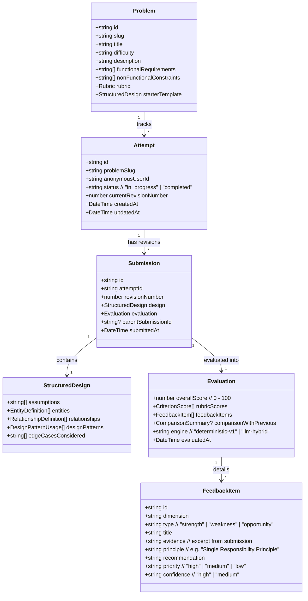
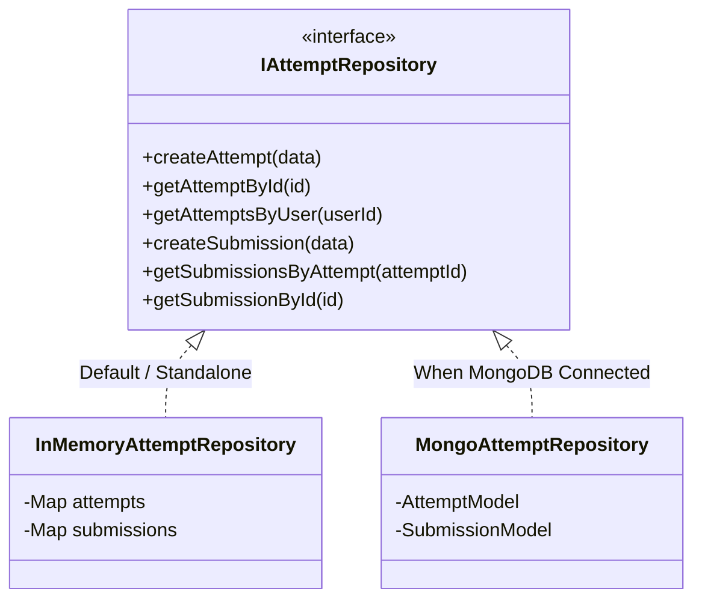

# DesignKarlo — Phase 2 Implementation Plan: Parking Lot Practice & Evaluation MVP

**Document Version:** 1.0.0  
**Status:** PROPOSED (Planning Only — Awaiting User Approval)  
**Target Milestone:** Phase 2 MVP  
**Reference Documents:** [`README.md`](file:///d:/MVP/README.md), [`docs/design-note.md`](file:///d:/MVP/docs/design-note.md), [`docs/research-note.md`](file:///d:/MVP/docs/research-note.md), [`AI_USAGE.md`](file:///d:/MVP/AI_USAGE.md)

---

## Executive Summary

Phase 1 established the verified monorepo foundation (`apps/web` with React/Vite/Tailwind and `apps/api` with Express/TypeScript/Zod), the neo-brutalist visual design tokens, and local Git repository.

Phase 2 transforms DesignKarlo into a fully functioning, end-to-end interactive practice application for its first Low-Level Design problem: **The Parking Lot System**.

In accordance with approved product decisions:
* **Practice Journey:** Anonymous practice session (no mandatory auth friction).
* **Format:** Explicit, structured text-based architectural submissions (no canvas drag-and-drop).
* **Evaluation:** Fixed, explainable, evidence-based rubric with a 100% deterministic local evaluation engine (runs out-of-the-box without paid AI keys, with an extensible adapter pattern for future LLM integration).
* **Attempt Comparison:** Longitudinal tracking where learners see concrete diffs, score deltas, and evidence of architectural improvement between Revision 1 and Revision 2+.
* **Persistence Strategy:** Clean repository abstraction (`InMemoryRepository` active out-of-the-box; `MongoRepository` ready when MongoDB is configured).

---

## 1. User Journey & Interaction Flow

```
[Problem Catalog]
       │
       ▼
[Parking Lot Overview] ──► Inspects Requirements, Constraints & Rubric
       │
       ▼
[Start Attempt] ──────────► Generates anonymous session & initializes Attempt
       │
       ▼
[Structured Editor] ──────► Inputs/edits Classes, Relationships, Patterns, Edge Cases
       │                    (Features "Load Starter Template" for rapid demonstration)
       ▼
[Submit Revision] ────────► Client validates schema ➔ API runs deterministic rubric
       │
       ▼
[Feedback Dashboard] ─────► Displays Overall Score, 4 Rubric Dimensions,
       │                    and Evidence-Backed Actionable Critiques
       ▼
[Revise Solution] ────────► Clones current revision into editor to address weaknesses
       │
       ▼
[Compare Attempts] ───────► Side-by-side comparison: Score Delta (+/-), Resolved
                            Smells, Added Abstractions, and Architectural Maturity
```

### Detailed Screen States
1. **Problem Discovery (`/problems/parking-lot`):**
   * Problem brief: Real-world requirements (vehicle types, ticket issuance, spot search, payment).
   * Evaluation rubric preview: Tells learner upfront how their design will be judged.
   * "Start Design Attempt" CTA.
2. **Design Studio (`/problems/parking-lot/attempt/:attemptId`):**
   * Left Pane: Functional constraints, non-functional goals, and rubric guidelines.
   * Right Pane: Sectional structured editor (Entities, Relationships, Patterns, Edge Cases) with live Zod format validation.
   * Fast Demo Helper: "Insert Sample Architecture" button to let evaluators test without manual typing.
3. **Evaluation & Feedback View (`/attempts/:attemptId/revisions/:revId`):**
   * Neo-brutalist score badge (`e.g., 72/100 • Grade: Proficient`).
   * 4-Dimension Rubric progress cards.
   * Itemized feedback cards with:
     * **Submission Evidence:** Exact class name or relationship cited.
     * **Design Principle:** SOLID rule or architectural concern violated/honored.
     * **Actionable Recommendation:** Specific suggestion for Revision 2.
   * Action buttons: "Revise Design (Attempt Revision 2)" and "View History".
4. **Multi-Attempt Comparison View (`/attempts/:attemptId/compare`):**
   * Visual delta between Revision 1 and Revision 2.
   * Score evolution line/badge (`+16 pts`).
   * Addressed issues checklist (e.g., `"✓ Resolved: Decoupled PricingStrategy from ParkingLot"`).

---

## 2. Proposed Domain Model & Entity Responsibilities



### Entity Responsibilities & Persistence Rationale
* **`Problem` (Static / In-Memory):**
  * *Responsibility:* Source of truth for requirements, starter template, and rubric criteria.
  * *Storage:* Static in-code problem registry (`src/data/problems/parkingLot.ts`). Does not require dynamic DB writes in MVP.
* **`Attempt` (Persistent):**
  * *Responsibility:* Aggregates a learner's multi-revision journey for a given problem and anonymous user session.
  * *Storage:* Persistent (InMemory store with Mongoose fallback schema). Needed to group submissions and load attempt history.
* **`Submission` (Persistent & Immutable):**
  * *Responsibility:* Immutable historical snapshot of a single design version.
  * *Storage:* Persistent. Must NEVER be updated in-place; revision 2 creates a new `Submission` record referencing the same `attemptId`.
* **`Evaluation` & `FeedbackItem` (Persistent with Submission):**
  * *Responsibility:* Stores computed scores, principle critiques, and revision comparison deltas.
  * *Storage:* Persisted embedded within or linked directly to the `Submission` snapshot.

---

## 3. Submission Format & Zod Validation Schema

The structured submission format avoids both the ambiguity of freeform essays and the mechanical friction of visual drag-and-drop canvases.

### Schema Definition (`packages/shared` or `apps/api/src/schemas/submission.ts`)

```typescript
import { z } from 'zod';

export const EntityDefinitionSchema = z.object({
  name: z.string().min(2, "Entity name must be at least 2 characters").regex(/^[A-Z][a-zA-Z0-9]*$/, "Entity name must be PascalCase"),
  type: z.enum(['class', 'interface', 'abstract_class', 'enum']),
  responsibilities: z.array(z.string().min(3)).min(1, "At least one responsibility required per entity"),
  attributes: z.array(z.string()).default([]),
  methods: z.array(z.string()).default([]),
});

export const RelationshipDefinitionSchema = z.object({
  source: z.string().min(2),
  target: z.string().min(2),
  type: z.enum(['has_a', 'has_many', 'inherits', 'implements', 'uses']),
  description: z.string().optional(),
});

export const DesignPatternUsageSchema = z.object({
  patternName: z.string().min(2), // e.g. "Strategy", "Factory", "Singleton", "Observer"
  targetEntity: z.string().min(2),
  justification: z.string().min(10, "Justification must be at least 10 characters explaining why this pattern was chosen"),
});

export const StructuredDesignSchema = z.object({
  problemSlug: z.literal('parking-lot'),
  assumptions: z.array(z.string().min(5)).min(1, "Specify at least one domain assumption"),
  entities: z.array(EntityDefinitionSchema).min(3, "A valid Parking Lot design must contain at least 3 distinct entities"),
  relationships: z.array(RelationshipDefinitionSchema).min(2, "Define at least 2 entity relationships"),
  designPatterns: z.array(DesignPatternUsageSchema).default([]),
  edgeCasesConsidered: z.array(z.string().min(5)).min(1, "Document at least one concurrency or capacity edge case"),
});

export type StructuredDesign = z.infer<typeof StructuredDesignSchema>;
export type EntityDefinition = z.infer<typeof EntityDefinitionSchema>;
export type RelationshipDefinition = z.infer<typeof RelationshipDefinitionSchema>;
export type DesignPatternUsage = z.infer<typeof DesignPatternUsageSchema>;
```

### Validation Error Handling
* Client-side: Inline feedback next to invalid fields (e.g. highlighting non-PascalCase entity names or missing relationships).
* Server-side: Returns structured 400 response with path-specific details:
  ```json
  {
    "success": false,
    "error": {
      "message": "Submission validation failed",
      "code": "VALIDATION_ERROR",
      "details": [
        { "path": "entities", "message": "A valid Parking Lot design must contain at least 3 distinct entities" }
      ]
    }
  }
  ```

---

## 4. Evaluation Strategy & Explainable Rubric

To satisfy the constraint that the app must be **fully demonstrable without paid AI keys**, Phase 2 introduces a **Deterministic Architectural Analyzer** alongside an extensible `IEvaluationEngine` interface.

### The 4 Rubric Dimensions for Parking Lot (Total: 100 points)

| Dimension | Weight | Max Pts | Target Concepts Inspected |
| :--- | :--- | :--- | :--- |
| **1. Domain Entity Modeling** | 25% | 25 pts | Recognizes `Vehicle` (or subtypes), `ParkingSpot` (or types), `Ticket`/`Receipt`, `ParkingFloor`/`Gate`, and core lot coordinator. |
| **2. Cohesion & SOLID Modularity** | 25% | 25 pts | Checks for God Class smell (e.g. `ParkingLot` doing pricing + hardware + allocation), checks separation of concerns, Single Responsibility. |
| **3. Extensibility & Patterns** | 25% | 25 pts | Evaluates spot allocation strategy (Strategy pattern), vehicle/spot factory (Factory pattern), pricing decoupling. |
| **4. Edge Cases & Concurrency** | 25% | 25 pts | Inspects handling for: full lot status, concurrent entrance/exit allocation race conditions, ticket lost/invalid. |

### Deterministic Rule Engine Architecture

The deterministic engine inspects the structured AST (Abstract Syntax Tree) of the submission:

1. **Entity Presence Matrix:**
   * Detects vehicle representation (`Vehicle`, `Car`, `Bike`, `Truck`).
   * Detects spot representation (`ParkingSpot`, `ParkingFloor`, `Slot`).
   * Detects transaction/ticket representation (`Ticket`, `ParkingTicket`, `Receipt`).
   * *Evidence Generated:* `"Identified core domain abstractions: ParkingLot, ParkingFloor, ParkingSpot, Vehicle, Ticket."`
2. **God Class & Cohesion Detector:**
   * Flags `ParkingLot` if it contains $> 4$ disparate responsibilities (e.g., `calculateFare`, `scanPlate`, `reserveSpot`, `processPayment`).
   * *Evidence Generated:* `"Class 'ParkingLot' manages spot search, fare calculation, and payment transactions directly."`
   * *Principle Cited:* `"Single Responsibility Principle (SRP)"`
   * *Recommendation:* `"Extract pricing into a dedicated PricingStrategy or FareService."`
3. **Pattern Consistency Checker:**
   * If learner claims `Strategy Pattern` for spot assignment, checks if an interface/class for assignment exists (e.g., `SpotAssignmentStrategy`, `NearestSpotStrategy`).
   * *Evidence Generated:* `"Strategy Pattern claimed for spot allocation, matching entity 'SpotAssignmentStrategy'."`
4. **Multi-Attempt Progression Analyzer:**
   * When evaluating Revision $N > 1$:
     * Checks if previously flagged high-priority weaknesses were addressed.
     * Computes metric deltas (e.g., `"Reduced responsibilities on ParkingLot from 5 to 2"`, `"Added 2 new specialized abstractions"`).
     * Awards progress bonus points and prints positive reinforcement:
       * *Evidence Generated:* `"Between Revision 1 and Revision 2, you decoupled fare calculation from ParkingLot into ParkingFeeCalculator. SRP compliance increased by 15%."`

---

## 5. API Contracts

### Endpoints Overview

| Method | Endpoint | Purpose | Request Body | Response Status |
| :--- | :--- | :--- | :--- | :--- |
| `GET` | `/api/problems` | List practice problems | None | `200 OK` (list) |
| `GET` | `/api/problems/:slug` | Problem details & rubric | None | `200 OK` (problem object) |
| `POST` | `/api/attempts` | Start or resume attempt | `{ problemSlug, anonymousUserId }` | `201 Created` / `200 OK` |
| `GET` | `/api/attempts/:id` | Get attempt & revision history | None | `200 OK` (attempt + revision list) |
| `POST` | `/api/attempts/:id/submissions` | Submit design revision & evaluate | `StructuredDesign` | `201 Created` (evaluated submission) |
| `GET` | `/api/attempts/:id/submissions/:subId` | View specific evaluated submission | None | `200 OK` (submission details) |
| `GET` | `/api/attempts/:id/compare` | Compare two revisions | Query: `?revA=1&revB=2` | `200 OK` (comparison payload) |

### Sample Response: `POST /api/attempts/:id/submissions`
```json
{
  "success": true,
  "data": {
    "submissionId": "sub_98f12a",
    "attemptId": "att_44b78c",
    "revisionNumber": 2,
    "submittedAt": "2026-10-14T04:15:00.000Z",
    "evaluation": {
      "overallScore": 84,
      "grade": "Proficient",
      "engine": "deterministic-v1",
      "rubricScores": [
        { "dimension": "domain_entities", "score": 23, "maxScore": 25, "rating": "Strong" },
        { "dimension": "solid_modularity", "score": 22, "maxScore": 25, "rating": "Strong" },
        { "dimension": "extensibility_patterns", "score": 21, "maxScore": 25, "rating": "Proficient" },
        { "dimension": "edge_cases_concurrency", "score": 18, "maxScore": 25, "rating": "Developing" }
      ],
      "feedbackItems": [
        {
          "id": "fb_1",
          "dimension": "solid_modularity",
          "type": "strength",
          "title": "Clean Separation of Pricing Logic",
          "evidence": "Class 'ParkingFeeCalculator' handles fee calculations based on VehicleType and duration.",
          "principle": "Single Responsibility Principle",
          "recommendation": "Maintained clean separation from core lot management.",
          "priority": "low",
          "confidence": "high"
        },
        {
          "id": "fb_2",
          "dimension": "edge_cases_concurrency",
          "type": "weakness",
          "title": "Concurrent Gate Spot Contention",
          "evidence": "Method 'ParkingLot.parkVehicle' queries available spots without reservation locks or synchronized slots.",
          "principle": "Thread Safety & Concurrency",
          "recommendation": "Introduce synchronized spot reservation or atomic state transitions in SpotManager to prevent multiple gates assigning the same slot.",
          "priority": "high",
          "confidence": "high"
        }
      ],
      "comparisonWithPrevious": {
        "previousRevisionNumber": 1,
        "scoreDelta": 16,
        "resolvedIssues": [
          "Decoupled pricing logic from ParkingLot into ParkingFeeCalculator"
        ],
        "newIssues": [],
        "summary": "Great progress! Your design is significantly more modular in Revision 2 with clear Single Responsibility boundaries."
      }
    }
  }
}
```

---

## 6. Persistence & Failure Handling

### Dual-Repository Pattern
To meet the constraint of **safe MongoDB integration without breaking local development or requiring Atlas credentials**:



1. **`InMemoryAttemptRepository`:**
   * Uses thread-safe JavaScript `Map` structures in memory.
   * Active automatically whenever MongoDB is disconnected or offline.
   * Ensures the entire application runs, tests pass, and evaluations succeed with zero environment setup.
2. **`MongoAttemptRepository`:**
   * Utilizes Mongoose models with strict schemas and indices on `attemptId` and `anonymousUserId`.
   * Swapped in transparently by a repository factory (`getRepository()`) when `isDbConnected()` is true.
3. **Safe Secrets & Environment:**
   * `.env.example` already documents `MONGODB_URI=mongodb://localhost:27017/designkarlo`.
   * No real credentials will be added or committed.
   * If MongoDB goes down mid-session, the server catches the timeout gracefully and continues operating.
4. **Duplicate Submission Prevention:**
   * Submissions are locked with idempotency hashes (SHA-256 of the design content). Submitting the exact same design within 5 seconds returns the existing evaluation without re-running.

---

## 7. Frontend User Experience & Neo-Brutalist Screens

The frontend will expand the existing neo-brutalist theme into interactive practice workflows:

1. **State Management:**
   * Lightweight client store or React context (`AttemptContext`) storing:
     * `anonymousUserId`: Generated on first visit (e.g. `anon_usr_7f82`) and stored in `localStorage`.
     * `activeAttempt`: Current attempt metadata and revision history.
     * `currentDraft`: Unsubmitted design draft (persisted in `localStorage` so refreshing does not wipe work).
2. **Component Breakdown (`apps/web/src/components/`):**
   * `ProblemHeader`: Title, difficulty badge, requirements accordion.
   * `StructuredEditor`:
     * Entity creator card (Name, Type dropdown, Responsibilities tag input, Methods/Attributes).
     * Relationship builder card (Source entity, Target entity, Relation type).
     * Design Patterns selector card.
     * Edge Cases checklist & notes.
     * **"Load Example Architecture"** quick-action button for effortless demoing.
   * `EvaluationCard`: Score display, progress bars, and feedback filters (All / High Priority / Strengths / Weaknesses).
   * `ComparisonDrawer`: Side-by-side revision inspector showing diffs and progress score.
3. **Loading & Error Handling:**
   * Neo-brutalist skeleton placeholders with high-contrast borders and animated pulse.
   * Clear error alerts with "Retry Request" actions.

---

## 8. Concrete Test Plan

### Backend Tests (`apps/api`)
1. **Schema Validation Tests (`tests/submission-schema.test.ts`):**
   * Rejects submissions with fewer than 3 entities.
   * Rejects non-PascalCase class names.
   * Rejects relationships referencing non-existent entities.
   * Accepts fully populated valid Parking Lot design payload.
2. **Deterministic Evaluation Engine Tests (`tests/evaluation-engine.test.ts`):**
   * Evaluates a naive "God Class" design: asserts low modularity score (<15/25) and verifies presence of SRP violation feedback with exact class evidence.
   * Evaluates a modular, well-decomposed design: asserts high modularity score (>20/25) and verifies detection of Strategy pattern.
   * Compares Revision 1 vs Revision 2: asserts correct `scoreDelta` calculation and detection of resolved issues.
3. **API Integration Tests (`tests/attempts-api.test.ts`):**
   * `POST /api/attempts` creates new attempt with generated UUID.
   * `POST /api/attempts/:id/submissions` stores revision 1 and returns 201 with evaluation.
   * `POST /api/attempts/:id/submissions` a second time creates revision 2 and includes `comparisonWithPrevious`.
   * `GET /api/attempts/:id/compare?revA=1&revB=2` returns revision diff.
4. **Repository Fallback Tests (`tests/repository.test.ts`):**
   * Verifies `InMemoryAttemptRepository` functions identically without MongoDB.

### Frontend Tests (`apps/web`)
1. **Editor Form Tests (`src/components/StructuredEditor.test.tsx`):**
   * Allows adding and removing entities.
   * Pre-populates fields when "Load Example Architecture" is clicked.
   * Disables submit button when validation requirements are not satisfied.
2. **Evaluation View Tests (`src/components/EvaluationDashboard.test.tsx`):**
   * Renders overall score badge, rubric dimension cards, and itemized evidence cards.
   * Filters feedback items by priority.
3. **Comparison View Tests (`src/components/ComparisonView.test.tsx`):**
   * Correctly displays score delta and lists resolved design violations.

---

## 9. Ordered Implementation Milestones

```
Milestone 2.1: Domain Schemas & Problem Definition (Backend)
     │
     ▼
Milestone 2.2: Deterministic Rubric & Evaluation Engine (Backend)
     │
     ▼
Milestone 2.3: Repository Layer & API Routes (Backend)
     │
     ▼
Milestone 2.4: Structured Design Editor & Template Loader (Frontend)
     │
     ▼
Milestone 2.5: Evaluation Dashboard & Evidence Feedback Display (Frontend)
     │
     ▼
Milestone 2.6: Attempt History & Revision Comparison Flow (Full-Stack)
     │
     ▼
Milestone 2.7: End-to-End Verification, Documentation & Walkthrough
```

| Milestone | Deliverables | Essential vs Optional | Effort Est. |
| :--- | :--- | :--- | :--- |
| **2.1: Domain & Schemas** | Zod schemas, TypeScript types, static Parking Lot problem specification | **Essential** | 1.5 hrs |
| **2.2: Evaluation Engine** | Deterministic rubric evaluator, pattern detector, evidence extractor | **Essential** | 3.0 hrs |
| **2.3: Repository & API** | Dual repository (InMemory + Mongo schema), API route handlers, integration tests | **Essential** | 2.5 hrs |
| **2.4: Structured Editor** | Neo-brutalist interactive design editor, validation state, sample filler | **Essential** | 3.5 hrs |
| **2.5: Feedback Dashboard** | Rubric score breakdown, evidence-backed feedback cards, revise action | **Essential** | 2.5 hrs |
| **2.6: Comparison View** | Side-by-side attempt comparison, score evolution, addressed smells | **Essential** | 2.0 hrs |
| **2.7: Polish & Verification** | End-to-end tests, docs update, local verification run | **Essential** | 1.5 hrs |
| *2.8: Optional Extension* | Read-only Mermaid class diagram preview from entities | *Optional / Deferred* | 1.5 hrs |

---

## 10. Risks, Assumptions & Unresolved Decisions

### Assumptions
1. **No External API Requirement:** The evaluator operates deterministically without requiring an OpenAI/Gemini/Anthropic API key, ensuring any evaluator or reviewer can run it out-of-the-box.
2. **Anonymous Session Scope:** Users are tracked via a client-generated UUID in `localStorage` (`anonymousUserId`). Cross-device synchronization is deferred beyond MVP.
3. **Single Active Problem:** The MVP focuses deeply on **Parking Lot System** to ensure high feedback quality rather than superficial coverage of 10 problems.

### Risks & Mitigations
* **Risk: Free-form submissions could confuse a deterministic analyzer.**  
  * *Mitigation:* The structured schema (classes, methods, relationships, patterns, edge cases) provides unambiguous AST nodes to evaluate deterministically.
* **Risk: Learners get discouraged by low scores without clear paths to improve.**  
  * *Mitigation:* Every feedback item explicitly couples **Evidence Found** with a concrete **Suggested Refinement**, and clicking "Revise" pre-fills their previous design so they only need to fix the highlighted flaw.

### Explicit Unresolved Decisions for User Approval
1. **Sample Pre-fill Feature:** Should the editor include a "Load Sample Architecture" button to allow instant demonstration during internship evaluation? *(Recommended: Yes)*
2. **Submission Format UI Style:** Should the structured editor use a clean multi-section form (Add Class, Add Relation, Add Pattern) or a split YAML/JSON code editor with live syntax checking? *(Recommended: Interactive multi-section form with an optional "View as JSON" toggle)*
3. **Scoring Strictness:** Should the deterministic engine grade strictly (average initial score 60-70/100 to emphasize the need for revision) or leniently (80+/100)? *(Recommended: Realistic/strict baseline ~65/100 on initial attempt so the revision progression shows clear, rewarding growth to 85+/100)*
